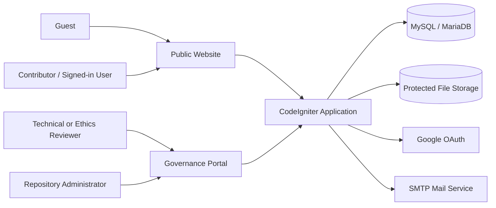
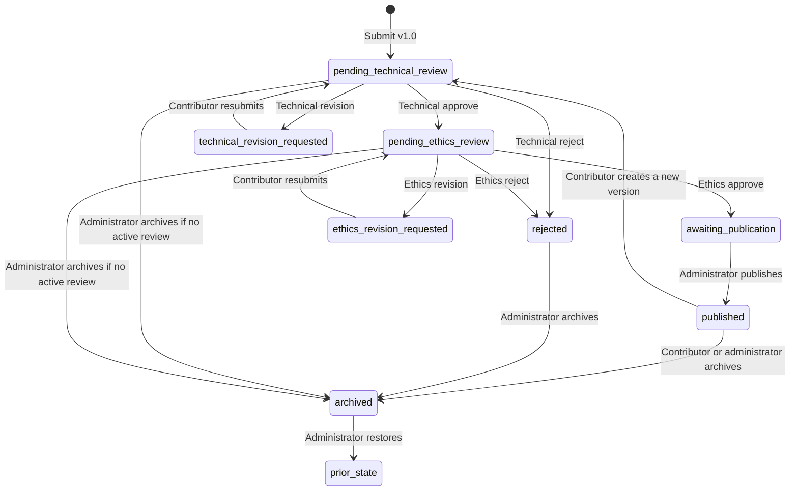
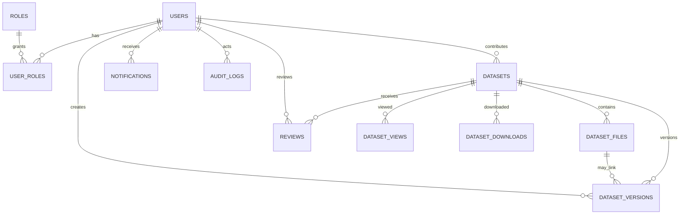

# **ASOG TBI Dataset Repository**

## **Full Software Documentation and As-Built System Specification**

**Document version:** 1.0
**System release:** Mainline milestone release / integrated CodeIgniter application
**Documentation date:** August 5, 2026
**Repository branch reviewed:** `main`
**Primary institutions:** ASOG Technology Business Incubator and the College of Computer Studies, Camarines Sur Polytechnic Colleges
**Document status:** Mainline release baseline

---

## **Document Control**

| Item | Value |
|---|---|
| Document purpose | Describe the software that is actually implemented, its requirements, architecture, data model, workflows, security controls, interfaces, operation, testing, limitations, and maintenance procedures |
| Intended audience | Project owners, developers, system administrators, reviewers, quality-assurance staff, research personnel, and future maintainers |
| Primary evidence | Application source code, routes, controllers, models, services, migrations, views, tests, configuration templates, repository documentation, and live browser inspection |
| Source-of-truth order | Running code and database migrations; automated tests; current repository documentation; the original SRS for historical intent |
| Supersedes | The original SRS only where the original document describes planned behavior that differs from the implemented system |
| Sensitive-data rule | This document names configuration keys but does not reproduce secrets, production credentials, reset tokens, session data, or the local `.env` file |

### **Status Legend**

| Status | Meaning |
|---|---|
| **Implemented** | Present in the current codebase and directly verifiable |
| **Conditional** | Implemented but requires environment configuration, an external service, an eligible user, or eligible data |
| **Deferred** | Intentionally outside the current release |
| **Known gap** | Present behavior, content, or configuration that needs correction or production hardening |

---

## **Table of Contents**

1. Introduction
2. Product Overview
3. System Scope and Release Boundary
4. Stakeholders, Users, and Roles
5. Functional Requirements
6. Dataset Lifecycle and Moderation Workflow
7. Access-Control and Authorization Model
8. External and Internal Interfaces
9. Application Architecture
10. Route and Endpoint Reference
11. Data Architecture and Database Dictionary
12. File and Storage Architecture
13. Authentication and Account Lifecycle
14. Search, Discovery, Citation, and Recommendation Logic
15. Notifications, Auditability, and Accountability
16. User Interface and Theme System
17. Security and Privacy
18. Non-Functional Requirements
19. Configuration and Environment
20. Installation, Setup, and Local Operation
21. Deployment and Production Readiness
22. Testing and Verification
23. Browser Audit Results
24. Error Handling and Troubleshooting
25. Known Gaps, Risks, and Deferred Work
26. Acceptance Criteria and Traceability
27. Maintenance Guide
28. Glossary
29. Documentation Provenance

---

## **1. Introduction**

### **1.1 Purpose**

The ASOG TBI Dataset Repository is a web-based institutional repository for collecting, reviewing, publishing, discovering, citing, and downloading research datasets. It centralizes datasets produced by thesis, capstone, artificial-intelligence, analytics, and related institutional research projects.

This document is an as-built specification. It records the behavior of the current integrated application rather than treating planned features as completed. It is designed to support:

1. system handover and institutional review;
2. development and maintenance;
3. reviewer and administrator training;
4. security and deployment assessment;
5. acceptance testing; and
6. future requirements planning.

### **1.2 Problem Addressed**

Research datasets are frequently stored in personal drives, individual computers, or project-specific folders. This makes them difficult to discover, validate, reuse, cite, and govern. The repository addresses this by providing:

- structured dataset metadata;
- protected ZIP-package storage;
- a technical-first, ethics-second review workflow;
- controlled publication and archive actions;
- role-aware discovery and download behavior;
- immutable review and audit records;
- citation generation; and
- a public-facing institutional catalog.

### **1.3 Definitions and Conventions**

- **Dataset** means the metadata record and its protected package.
- **Version** means a point-in-time dataset revision linked to a file where applicable.
- **Published** means the current version has completed technical and ethics review and has been released by an administrator.
- **Active review** means a review assignment whose status is `assigned`.
- **Contributor** means the user who owns and submits a dataset.
- **Maintainer** means an ethics reviewer, technical reviewer, or repository administrator.
- **Protected package** means a ZIP file stored below `writable/uploads`, never linked directly as a public static asset.
- Route parameters are shown in braces, for example `/datasets/{id}`.

---

## **2. Product Overview**

### **2.1 Product Perspective**

The system is one integrated CodeIgniter 4 application with two related presentation surfaces:

1. a public and contributor-facing website; and
2. a governance portal for reviewers and administrators.

Both surfaces share the same user accounts, sessions, database, dataset records, notification system, audit log, and moderation service. The governance portal is not a separate application.

### **2.2 Product Objectives**

| ID | Objective | Current state |
|---|---|---|
| OBJ-01 | Centralize institutional research datasets | Implemented |
| OBJ-02 | Make approved public datasets discoverable | Implemented |
| OBJ-03 | Require technical and ethics review before publication | Implemented |
| OBJ-04 | Protect package downloads behind authenticated authorization | Implemented |
| OBJ-05 | Preserve dataset versions and review history | Implemented |
| OBJ-06 | Support institutional Google identity | Conditional on Google OAuth configuration |
| OBJ-07 | Support approved external collaborators | Implemented through administrator-issued password accounts |
| OBJ-08 | Provide accountable administrative actions | Implemented through audit logging |
| OBJ-09 | Automate file-content safety inspection | Deferred |
| OBJ-10 | Provide advanced usage analytics and reports | Deferred |

### **2.3 Technology Baseline**

| Layer | Technology |
|---|---|
| Server application | PHP 8.2 or newer |
| Framework | CodeIgniter 4.7.4 |
| Dependency management | Composer |
| Database | MySQL or MariaDB |
| Frontend | Server-rendered PHP views, modular CSS, and browser JavaScript |
| Automated testing | PHPUnit 10.5.64 |
| Authentication | Local password accounts and Google OAuth 2.0/OpenID profile retrieval |
| File storage | Local server filesystem under CodeIgniter `WRITEPATH` |

### **2.4 High-Level Context**



Google and SMTP integrations are conditional. Core local-password operation, dataset management, moderation, and catalog behavior do not require Google OAuth.

---

## **3. System Scope and Release Boundary**

### **3.1 Included in the Current Release**

The current release includes:

- public homepage, About pages, and dataset catalog;
- dataset detail, metadata, view counts, download counts, citations, and related-dataset recommendations;
- local-password and institutional Google authentication;
- administrator-issued password accounts;
- password reset for local accounts;
- account settings;
- contributor upload, editing, versioning, archive, and workflow tracking;
- automatic and manual reviewer assignment;
- technical review;
- ethics review;
- draft checklists, decisions, reassignment, and immutable review history;
- administrator publication, archive, restoration, user/role management, and audit-log viewing;
- in-application notifications and polling;
- light and dark themes;
- role-specific portal navigation;
- protected cover and ZIP-file delivery;
- database migrations and demonstration seed data; and
- automated feature, unit, contract, citation, access, workflow, and theme tests.

### **3.2 Conditional Capabilities**

| Capability | Dependency |
|---|---|
| Google sign-in | Valid Google client ID, client secret, redirect URI, network access, and verified `my.cspc.edu.ph` account |
| Password-reset email delivery | Correct SMTP configuration and reachable mail server |
| Automatic assignment | At least one active user with the required reviewer role |
| Popular-dataset section | Published public datasets with recorded views outside the featured set |
| Dataset download | An eligible signed-in user and an existing protected file |
| Production HTTPS | Web-server TLS configuration and secure application/cookie settings |

### **3.3 Explicitly Deferred**

- automated ZIP integrity and content diagnostics;
- malware scanning;
- automated detection of sensitive or personally identifiable information;
- generalized workflow email notifications;
- in-browser database backup and restore;
- advanced exports and institutional analytics;
- formal restricted-access request and approval workflow;
- saved user preferences beyond local theme state;
- behavioral or machine-learning recommendations;
- public API access;
- DOI registration and management; and
- public self-registration with immediate account creation.

### **3.4 Important Scope Clarifications**

1. The `/register` screen is an access-request information page, not a public account-creation form.
2. Technical review occurs before ethics review.
3. Only an administrator can publish a dataset.
4. All download routes require authentication, including public datasets.
5. “Restricted” currently means visible and downloadable to any authenticated account; there is no per-dataset approval record. This differs from some interface wording and must not be interpreted as implemented request-based authorization.
6. Review checks are human judgments. The system stores the checklist and enforces workflow rules but does not inspect ZIP contents automatically.

---

## **4. Stakeholders, Users, and Roles**

### **4.1 Stakeholders**

| Stakeholder | Interest |
|---|---|
| ASOG TBI | Repository sponsorship, research hosting, governance, and access policy |
| College of Computer Studies, CSPC | Academic dataset production, quality review, and research use |
| Research Ethics Board or ethics reviewers | Consent, privacy, anonymization, and responsible-data review |
| Technical reviewers | Package readability, documentation, format, and technical quality |
| Repository administrators | Accounts, assignments, publication, archives, and accountability |
| Contributors | Submission, revision, lifecycle tracking, citation, and publication |
| Students, faculty, and researchers | Dataset discovery and authorized reuse |
| External collaborators | Approved password-based authenticated access |
| Developers and operators | Maintenance, deployment, backups, monitoring, and incident response |

### **4.2 Application Roles**

| Role value | Display role | Core permissions |
|---|---|---|
| None | Guest | Browse public pages and public catalog metadata |
| `user` | Contributor / repository user | Download eligible published datasets, upload datasets, manage owned records, receive notifications |
| `technical reviewer` | Technical Reviewer | Access assigned technical reviews and protected packages; save drafts; decide |
| `ethics reviewer` | Ethics Reviewer | Access assigned ethics reviews and protected packages; save drafts; decide |
| `repository administrator` | Repository Administrator | Governance dashboard, user/role administration, assignment, publication, lifecycle controls, audit logs |

### **4.3 Multi-Role Accounts**

Users may hold multiple roles. Authorization passes when a signed-in account has any role allowed by a route. The session stores both a primary role and the full roles array for compatibility and navigation.

An administrator may also hold reviewer and contributor roles. Role assignment does not create a separate identity or session.

### **4.4 Role Governance Rules**

- Accounts have `active` or `inactive` status.
- An inactive account is rejected even if an old session exists.
- An administrator cannot deactivate their own account.
- An administrator cannot remove their own administrator role.
- The final active administrator cannot be removed or deactivated.
- A reviewer with active assignments cannot lose the relevant role or be deactivated until those reviews are reassigned.
- Role and status changes are performed in a database transaction.
- Activating an eligible reviewer triggers distribution attempts for unassigned backlog records.

---

## **5. Functional Requirements**

### **5.1 Public Website**

| ID | Requirement | Implementation |
|---|---|---|
| PUB-FR-01 | The system shall display institutional branding and repository purpose. | Homepage, header, footer, and About pages |
| PUB-FR-02 | The homepage shall show recently published public datasets. | Five newest published, nonarchived public datasets |
| PUB-FR-03 | The homepage shall show popular public datasets when view data exists. | Up to five records, ordered by views and excluding the featured set |
| PUB-FR-04 | Guests shall browse published public dataset metadata. | Public catalog and detail routes |
| PUB-FR-05 | The system shall provide platform and partner information. | `/about/platform` and `/about/partners` |
| PUB-FR-06 | The system shall provide light and dark themes. | Theme toggle with site-layout isolation |
| PUB-FR-07 | The system shall not expose protected ZIP paths as static URLs. | Controller-streamed download response |

### **5.2 Catalog and Discovery**

| ID | Requirement | Implementation |
|---|---|---|
| CAT-FR-01 | Users shall search by title, description, tags, category, or disclosed content format. | `q` search across joined conditions |
| CAT-FR-02 | Users shall filter by data type. | Text, Image, Audio, Video, and Tabular |
| CAT-FR-03 | Users shall filter by category and upload date. | Query-string filters |
| CAT-FR-04 | The catalog shall paginate results. | 10 records per page |
| CAT-FR-05 | Guests shall only see public published records. | Implemented query scope |
| CAT-FR-06 | Signed-in users shall see public, institutional, and restricted published records. | Implemented query scope |
| CAT-FR-07 | Private records shall not appear in the general catalog. | Implemented |
| CAT-FR-08 | Archived records shall not appear in public discovery. | `archived_at IS NULL` and published-state checks |
| CAT-FR-09 | Detail views shall show metadata, file summary, counts, citation tools, and recommendations. | Implemented |
| CAT-FR-10 | A published detail view shall record a view event. | Implemented |

### **5.3 Authentication and Access Requests**

| ID | Requirement | Implementation |
|---|---|---|
| AUTH-FR-01 | Local users shall sign in with email and password. | Password hash verification |
| AUTH-FR-02 | Inactive accounts shall be blocked. | Login and per-request authentication filter |
| AUTH-FR-03 | CSPC users shall be able to sign in with Google. | Conditional Google OAuth flow |
| AUTH-FR-04 | Google sign-in shall accept only verified institutional email addresses. | Verified email plus `my.cspc.edu.ph` domain check |
| AUTH-FR-05 | Local accounts shall not be silently converted to Google accounts. | Explicit collision protection |
| AUTH-FR-06 | Public self-registration shall not create accounts. | Request-information page and administrator issuance |
| AUTH-FR-07 | Local users shall request a short-lived password-reset link. | 30-minute, single-use token |
| AUTH-FR-08 | Password-reset responses shall not disclose account existence. | Opaque response behavior |
| AUTH-FR-09 | Logout shall invalidate the session and be audited. | Authenticated POST route |

### **5.4 Account Settings**

| ID | Requirement | Implementation |
|---|---|---|
| ACC-FR-01 | Local-password users shall edit their name and email. | Implemented |
| ACC-FR-02 | Local-password users shall change password after supplying the current password. | Minimum eight characters |
| ACC-FR-03 | Google-managed name and email shall be read-only. | Google is the identity source of truth |
| ACC-FR-04 | Google accounts shall not expose local password controls. | Implemented |
| ACC-FR-05 | The settings page shall show status, roles, sign-in method, login time, and creation time. | Implemented |

### **5.5 Dataset Submission**

| ID | Requirement | Implementation |
|---|---|---|
| SUB-FR-01 | A signed-in user shall upload a new dataset. | Authenticated GET/POST upload routes |
| SUB-FR-02 | A submission shall include title, description, category, tags, data type, content formats, source type, research title, project head, access type, and anonymization confirmation. | Server validation |
| SUB-FR-03 | The dataset package shall be a ZIP file. | Extension validation and normalized package type |
| SUB-FR-04 | A cover image shall be optional. | JPG, PNG, or WebP; 4 MB; maximum 4000 × 4000 |
| SUB-FR-05 | A source link, when supplied, shall be a valid HTTPS-style URL accepted by strict URL validation. | Implemented |
| SUB-FR-06 | New records shall start at version 1.0 and pending technical review. | Implemented |
| SUB-FR-07 | The system shall create a dataset file and version record. | Transactional submission |
| SUB-FR-08 | The system shall attempt automatic technical-review assignment. | Implemented |
| SUB-FR-09 | The system shall notify the contributor and administrators of relevant submission events. | In-application notifications |
| SUB-FR-10 | The system shall audit the submission. | Implemented |

### **5.6 Contributor Workspace and Revisions**

| ID | Requirement | Implementation |
|---|---|---|
| CON-FR-01 | Contributors shall see only their owned datasets in their workspace. | Implemented |
| CON-FR-02 | The workspace shall summarize total, under-review, action-needed, and published records. | Implemented |
| CON-FR-03 | Contributors shall filter by workflow stage, access, and search text. | Implemented; 12 records per page |
| CON-FR-04 | Contributors shall see latest reviewer comments and the next required action. | Implemented |
| CON-FR-05 | Contributors shall edit a record only during a revision request or after publication. | Implemented lock |
| CON-FR-06 | Updating a published record shall create a new version and restart technical review. | Implemented |
| CON-FR-07 | A technical revision shall return to technical review; an ethics revision shall return to ethics review. | Implemented |
| CON-FR-08 | Contributors shall optionally replace the ZIP during an update. | ZIP, maximum 10 MB |
| CON-FR-09 | Contributors shall archive their own record when no active review blocks the action. | Implemented |
| CON-FR-10 | Contributors shall not restore archived records themselves. | Administrator-only restoration |

### **5.7 Technical Review**

| ID | Requirement | Implementation |
|---|---|---|
| TEC-FR-01 | An eligible reviewer shall see assigned technical reviews. | Role and assignment scoped queue |
| TEC-FR-02 | The reviewer shall access the protected current ZIP. | Controller-streamed reviewer download |
| TEC-FR-03 | The reviewer shall complete structured checklist results. | `confirmed`, `issue`, or `not_reviewed` |
| TEC-FR-04 | An issue result shall require an item note. | Service validation |
| TEC-FR-05 | The reviewer shall save a draft without changing dataset state. | Checklist JSON, comments, and `draft_saved_at` |
| TEC-FR-06 | Approval shall require all items to be confirmed. | Service validation |
| TEC-FR-07 | Reject and revision decisions shall require comments. | Service validation |
| TEC-FR-08 | Approval shall move the record to pending ethics review. | Implemented |
| TEC-FR-09 | Revision shall move the record to technical revision requested. | Implemented |
| TEC-FR-10 | Rejection shall move the record to rejected. | Implemented |

The technical checklist contains:

1. ZIP package is readable;
2. metadata is complete;
3. documentation is sufficient;
4. disclosed formats match the submitted materials; and
5. files are suitable for repository use.

### **5.8 Ethics Review**

| ID | Requirement | Implementation |
|---|---|---|
| ETH-FR-01 | Ethics review shall begin only after technical approval. | State transition enforced |
| ETH-FR-02 | An eligible reviewer shall see only assigned ethics reviews. | Role and assignment scoped queue |
| ETH-FR-03 | The ethics reviewer shall see prior technical approval context. | Review detail |
| ETH-FR-04 | Draft, checklist, issue-note, approval, revision, and rejection rules shall match the structured review contract. | Implemented |
| ETH-FR-05 | Approval shall move the record to awaiting publication. | Implemented |
| ETH-FR-06 | Revision shall move the record to ethics revision requested. | Implemented |
| ETH-FR-07 | Rejection shall move the record to rejected. | Implemented |

The ethics checklist contains:

1. consent or ethics clearance is documented;
2. personal or sensitive information is anonymized;
3. safeguards for sensitive data are adequate;
4. the source and collection method are legitimate; and
5. the requested access classification is appropriate.

### **5.9 Reviewer Queue**

| ID | Requirement | Implementation |
|---|---|---|
| REV-FR-01 | The queue shall support Needs action, Completed, and All records tabs. | Implemented |
| REV-FR-02 | The queue shall filter by search, age, access type, and data type. | Implemented |
| REV-FR-03 | The queue shall sort by assignment age, dataset title, or contributor. | Implemented |
| REV-FR-04 | The queue shall show active, aging, weekly-completed, and revision-decision counts. | Implemented |
| REV-FR-05 | Reassigned reviews shall no longer appear as active work. | Implemented |
| REV-FR-06 | Review decisions and reassignment history shall remain available. | Implemented |

### **5.10 Administration**

| ID | Requirement | Implementation |
|---|---|---|
| ADM-FR-01 | The administrator shall see counts by moderation stage. | Governance overview |
| ADM-FR-02 | The administrator shall see oldest records requiring attention. | Eight-record attention list |
| ADM-FR-03 | The moderation board shall filter by stage, reviewer, age, access, data type, and search. | Implemented; 12 per page |
| ADM-FR-04 | The administrator shall inspect metadata, files, versions, reviews, approvals, and recent audit events. | Dataset inspection page |
| ADM-FR-05 | The administrator shall manually assign an unassigned review. | Implemented |
| ADM-FR-06 | The administrator shall reassign an active review with a reason. | Implemented |
| ADM-FR-07 | The system shall close the old review and preserve it in history. | Status `reassigned` |
| ADM-FR-08 | The administrator shall publish only after both stages approve the current version. | Implemented |
| ADM-FR-09 | Publication shall set the final access type, approver, and approval time. | Implemented |
| ADM-FR-10 | The administrator shall archive a dataset with a reason when no active review exists. | Implemented |
| ADM-FR-11 | The administrator shall restore an archived dataset to its prior state. | Implemented |
| ADM-FR-12 | Restoration to a pending stage shall attempt automatic assignment. | Implemented |
| ADM-FR-13 | The administrator shall create local-password accounts. | Implemented |
| ADM-FR-14 | The administrator shall manage multi-role and active/inactive state safely. | Implemented governance rules |
| ADM-FR-15 | The administrator shall search recent audit events. | Latest 250 records are queried |

---

## **6. Dataset Lifecycle and Moderation Workflow**

### **6.1 State Model**



### **6.2 State Dictionary**

| Stored status | Meaning | Primary actor expected next |
|---|---|---|
| `pending_technical_review` | Waiting for or undergoing technical review | Technical reviewer or administrator |
| `technical_revision_requested` | Technical changes required | Contributor |
| `pending_ethics_review` | Technical stage approved; waiting for ethics decision | Ethics reviewer or administrator |
| `ethics_revision_requested` | Ethics changes required | Contributor |
| `awaiting_publication` | Both stages approved | Administrator |
| `published` | Available according to access classification | Repository users |
| `rejected` | Review ended with rejection | Contributor and administrator |
| `archived` | Removed from active/public use while history is retained | Administrator |

### **6.3 Version Rules**

- A new upload creates version `1.0`.
- An edit creates a new dataset-version record.
- A replacement ZIP creates a new dataset-file record linked to the new version.
- A metadata-only revision can point to the current file.
- Updating a published dataset invalidates prior publication for the new version and restarts technical review.
- Reviews may reference a dataset version so the decision remains associated with the reviewed submission.
- Review records are not overwritten when assignments or rounds change.

### **6.4 Assignment Algorithm**

Automatic assignment:

1. selects active users with the required reviewer role;
2. counts each candidate's active assigned reviews for that stage;
3. prioritizes the lowest active workload;
4. breaks ties by the longest period since prior assignment;
5. uses user ID for deterministic final ordering;
6. creates an `assigned` review with assignment method `automatic`; and
7. notifies the assigned reviewer.

If no eligible reviewer exists, the dataset remains unassigned, administrators are notified, and the event is audited as deferred assignment. Administrators may later assign manually. Enabling or activating a reviewer also triggers backlog-distribution attempts.

### **6.5 Review Rounds and Reassignment**

- The first assignment for a stage starts round 1.
- A new review after a completed revision cycle may use the next round.
- Manual reassignment requires a reason and a different eligible reviewer.
- The old review becomes `reassigned`.
- The replacement review remains in the same round and is marked with assignment method `manual`.
- Old checklist results, comments, dates, and assignment information remain in the timeline.

### **6.6 Decision Rules**

| Decision | Checklist rule | Comment rule | Dataset result |
|---|---|---|---|
| Approve | Every item must be `confirmed` | Optional | Advance to next gate |
| Revision | Issues may be recorded | Required | Return to contributor |
| Reject | Issues may be recorded | Required | `rejected` |
| Save draft | Partial checklist allowed | Optional | No dataset-state change |

All workflow mutations execute within database transactions and generate audit and notification side effects.

---

## **7. Access-Control and Authorization Model**

### **7.1 Route-Level Controls**

- The global CSRF filter protects state-changing form requests.
- `AuthFilter` requires a current active session user.
- `RoleFilter` requires at least one allowed role.
- Contributor ownership checks are performed inside dataset controllers.
- Reviewer access requires role, stage, assignment, and active review relationship.
- Administrator routes require `repository administrator`.

### **7.2 Dataset Visibility and Download Matrix**

| Access type | Guest catalog/detail | Signed-in catalog/detail | Download by ordinary signed-in user | Contributor/Admin access |
|---|---:|---:|---:|---:|
| Public | Yes, when published and not archived | Yes | Yes | Yes |
| Institutional | No | Yes, when published and not archived | Yes | Yes |
| Restricted | No | Yes, when published and not archived | **Yes in current implementation** | Yes |
| Private | No | No in general catalog | No | Owner and administrator only |
| Unpublished | No, except no public access | Owner/admin or assigned reviewer in scoped views | Owner/admin/reviewer only where explicitly authorized | Scoped |
| Archived | No | No in general catalog | No ordinary access | Administrator inspection and restore |

Every ordinary dataset download requires a signed-in account. A guest attempting a download is redirected to sign in, and the denial is audited.

### **7.3 Access-Control Caveat**

The model description for restricted datasets says downloads require repository authorization, but the current authorization method permits all active signed-in users to download published restricted records. Until a request/approval table and decision workflow are implemented, restricted access must be treated operationally as “authenticated repository access,” not individually approved access.

---

## **8. External and Internal Interfaces**

### **8.1 Browser Interface**

The application is server rendered and supports current desktop and mobile browsers with:

- semantic headings and landmark regions;
- keyboard-addressable links, buttons, form fields, tabs, and dialogs;
- responsive navigation and catalog filtering;
- paginated datasets and work queues;
- JavaScript-enhanced modals, custom selects, notification polling, theme switching, and citation copying.

Core routing and form processing remain server side.

### **8.2 Google Interface**

The Google authentication flow uses:

- OAuth 2.0 authorization-code flow;
- CSRF `state` verification;
- scopes `openid`, `email`, and `profile`;
- Google token endpoint;
- Google profile/user-information endpoint;
- verified email requirement; and
- institutional-domain validation.

Google access tokens are used to retrieve the profile and are not stored as long-term application credentials.

### **8.3 Email Interface**

SMTP is used only for local-account password reset in the current release. The message contains a one-time reset URL. In development, the application may also expose the reset link through flash data for testing.

General workflow events use in-application notifications rather than email.

### **8.4 Database Interface**

CodeIgniter's database layer and models access MySQL/MariaDB. Migrations are the authoritative schema definition. Foreign keys and transactions protect key workflow relationships.

### **8.5 Filesystem Interface**

The application writes:

- dataset packages below `writable/uploads/datasets/{datasetId}`;
- cover images below `writable/uploads/dataset-covers/{datasetId}`;
- sessions below `writable/session`;
- logs, cache, and framework runtime data below `writable`.

The web server must allow the PHP process to write these locations while denying direct public access to protected packages.

---

## **9. Application Architecture**

### **9.1 Architectural Style**

The application follows CodeIgniter's MVC structure with a domain service for moderation:

```text
HTTP Request
  -> Route
  -> Global / route filters
  -> Controller
  -> Models and ModerationWorkflow service
  -> MySQL/MariaDB and protected filesystem
  -> View or streamed file / JSON response
```

### **9.2 Major Components**

| Component | Responsibility |
|---|---|
| `Home` controller | Homepage and About pages |
| `Auth` controller | Local login, Google OAuth, access request, password reset, logout |
| `Account` controller | Profile and local-password maintenance |
| `Datasets` controller | Catalog, detail, cover, download, edit, update, contributor archive |
| `DatasetUpload` controller | New dataset submission and file persistence |
| `Dashboard` controller | Contributor workspace and notification endpoints |
| `Reviews` controller | Reviewer queues, detail, draft, decision, and protected review download |
| `Admin` controller | Governance overview, moderation, users, assignments, publication, archives, audit logs |
| `ModerationWorkflow` service | Transactional assignment, reassignment, decisions, publication, archive, restore, notifications, and audit |
| Models | Table access, constants, labels, workflow presentation, and query helpers |
| Helpers | Dataset presentation, citations, and recommendations |
| Views and CSS modules | Public website and governance portal presentation |

### **9.3 Directory Map**

```text
app/
  Config/                 Routes, filters, database, security, sessions, mail, Google
  Controllers/            HTTP request handling
  Database/
    Migrations/           Schema history
    Seeds/                Demo roles, users, datasets, and workflow data
  Filters/                Session and role authorization
  Helpers/                Citation, recommendation, and dataset presentation logic
  Models/                 Database models and domain constants
  Services/               ModerationWorkflow
  Views/
    account/ auth/        Identity and recovery screens
    admin/ reviews/       Governance portal
    dashboard/ datasets/  Contributor and catalog screens
    home/ layouts/        Public pages and shared layouts
public/
  assets/css/             Foundation and route/feature CSS modules
  assets/js/              Theme and interface behavior
tests/
  feature/ unit/ session/ Automated verification
writable/
  uploads/                Protected dataset and cover files
  logs/ cache/ session/   Runtime state
```

### **9.4 Presentation Boundaries**

`layouts/main.php` renders public, authentication, account, catalog, upload, and contributor pages. `layouts/portal.php` renders reviewer and administrator workspaces.

The main layout conditionally loads route-specific CSS. Portal CSS is isolated to the governance layout. Theme state is normalized at the layout boundary so an admin-page theme cannot leak incompatible styling into the public site after navigation.

---

## **10. Route and Endpoint Reference**

### **10.1 Public and Authentication Routes**

| Method | Route | Access | Handler / purpose |
|---|---|---|---|
| GET | `/` | Public | Homepage |
| GET | `/about/platform` | Public | Platform description |
| GET | `/about/partners` | Public | Partners and team |
| GET | `/datasets` | Public | Catalog |
| GET | `/datasets/{id}` | Public with record authorization | Dataset detail |
| GET | `/datasets/{id}/cover` | Public with record fallback | Cover or placeholder |
| GET | `/datasets/{id}/download` | Signed-in authorization | Protected package download |
| GET | `/login` | Public | Sign-in page |
| POST | `/login` | Public, CSRF | Local-password sign-in |
| GET | `/auth/google` | Public | Begin Google OAuth |
| GET | `/auth/google/callback` | Public | Complete Google OAuth |
| GET | `/register` | Public | Access-request information |
| POST | `/register` | Public, CSRF | Compatibility request response; no account creation |
| GET | `/forgot-password` | Public | Reset request form |
| POST | `/forgot-password` | Public, CSRF | Create and send reset link |
| GET | `/reset-password` | Public | Validate token and show reset form |
| POST | `/reset-password` | Public, CSRF | Set new password |
| POST | `/logout` | Authenticated, CSRF | Logout |

### **10.2 Contributor and Account Routes**

| Method | Route | Access | Purpose |
|---|---|---|---|
| GET | `/account/settings` | Authenticated | Account summary and settings |
| POST | `/account/settings` | Authenticated, CSRF | Update eligible account fields |
| GET | `/dashboard` | Authenticated | Contributor dataset workspace |
| GET | `/portal/dashboard` | Authenticated | Role-aware portal entry |
| GET | `/portal/datasets/{id}` | Authenticated owner/admin | Contributor workflow detail |
| GET | `/upload` | Authenticated | Submission form |
| POST | `/upload` | Authenticated, CSRF | Create dataset, file, and version |
| GET | `/datasets/{id}/edit` | Owner | Eligible revision form |
| POST | `/datasets/{id}/update` | Owner, CSRF | Create revised version |
| POST | `/datasets/{id}/archive` | Owner, CSRF | Archive eligible owned dataset |
| POST | `/notifications/{id}/read` | Authenticated, CSRF | Mark one notification read |
| POST | `/notifications/read-all` | Authenticated, CSRF | Mark all notifications read |
| GET | `/notifications/poll` | Authenticated | Return notification state as JSON |

### **10.3 Reviewer Routes**

| Method | Route | Access | Purpose |
|---|---|---|---|
| GET | `/review/technical` | Technical reviewer | Technical queue |
| GET | `/review/technical/{id}` | Assigned technical reviewer | Review detail |
| POST | `/review/technical/{id}/draft` | Assigned technical reviewer, CSRF | Save draft |
| POST | `/review/technical/{id}/decision` | Assigned technical reviewer, CSRF | Submit decision |
| GET | `/review/technical/{id}/download` | Assigned technical reviewer | Protected package |
| GET | `/review/ethics` | Ethics reviewer | Ethics queue |
| GET | `/review/ethics/{id}` | Assigned ethics reviewer | Review detail |
| POST | `/review/ethics/{id}/draft` | Assigned ethics reviewer, CSRF | Save draft |
| POST | `/review/ethics/{id}/decision` | Assigned ethics reviewer, CSRF | Submit decision |
| GET | `/review/ethics/{id}/download` | Assigned ethics reviewer | Protected package |

### **10.4 Administrator Routes**

| Method | Route | Purpose |
|---|---|---|
| GET | `/admin` | Governance overview |
| GET | `/admin/datasets` | Moderation board |
| GET | `/admin/datasets/{id}` | Dataset inspection |
| POST | `/admin/datasets/{id}/assign` | Manual assignment |
| POST | `/admin/datasets/{id}/reassign` | Reassignment with reason |
| POST | `/admin/datasets/{id}/publish` | Publication |
| POST | `/admin/datasets/{id}/archive` | Administrative archive |
| POST | `/admin/datasets/{id}/restore` | Restore prior lifecycle state |
| GET | `/admin/users` | User and role directory |
| POST | `/admin/users` | Create password account |
| POST | `/admin/users/{id}` | Update roles or status |
| GET | `/admin/audit-logs` | Search recent audit events |

All administrator routes require an active authenticated account with the `repository administrator` role. State-changing routes also receive global CSRF protection.

---

## **11. Data Architecture and Database Dictionary**

### **11.1 Entity Relationships**



### **11.2 `users`**

Purpose: application identities and authentication state.

| Field | Description |
|---|---|
| `id` | Primary key |
| `name` | Display name |
| `email` | Unique sign-in email |
| `google_sub` | Unique Google subject identifier; nullable |
| `auth_provider` | `local` or `google` |
| `avatar_url` | Google profile image URL; nullable |
| `email_verified_at` | Verification timestamp; nullable |
| `password_hash` | Local password hash; nullable for Google-only accounts |
| `status` | Active/inactive account state |
| `last_login_at` | Most recent successful login |
| `first_login_at` | First successful login |
| timestamps | Creation and update times |

### **11.3 `roles` and `user_roles`**

`roles` stores unique role names and descriptions. `user_roles` is the many-to-many join between users and roles. Foreign-key cascades remove role assignments if a user or role is deleted.

### **11.4 `datasets`**

Purpose: canonical metadata and current lifecycle state.

| Field group | Fields and meaning |
|---|---|
| Identity | `id`, `title`, `description`, `category`, `tags` |
| Classification | `data_type`, normalized `file_format` (`ZIP`), `content_formats`, `access_type` |
| Research context | `research_title`, `project_head`, `members`, `source_type`, `source_link`, legacy `form` |
| Ownership | `contributor_id` |
| Ethics declaration | `anonymized` |
| Presentation | `cover_image` protected relative path |
| Lifecycle | `status`, `version`, `approved_by`, `approved_at` |
| Archive | `archived_at`, `archived_from_status` |
| Audit timestamps | `created_at`, `updated_at` |

Indexes support status/data-type querying. The contributor foreign key cascades; the approving administrator becomes null if that account is removed.

### **11.5 `dataset_files`**

Stores each protected package:

- dataset relationship;
- randomized stored name;
- original client filename;
- relative path;
- byte size;
- MIME type;
- uploader;
- creation and update times.

The current application treats these records as protected resources and resolves the absolute path only after authorization.

### **11.6 `dataset_versions`**

Stores:

- dataset;
- semantic version string;
- revision summary;
- optional dataset-file relationship;
- creator; and
- timestamps.

This table preserves metadata-only and file-replacement revisions.

### **11.7 `reviews`**

| Field | Description |
|---|---|
| `dataset_id` | Reviewed dataset |
| `dataset_version_id` | Version reviewed, when available |
| `stage` | `technical` or `ethics` |
| `round` | Review-cycle number |
| `reviewer_id` | Assigned reviewer |
| `assigned_by` | Administrator/system actor represented by a user where applicable |
| `assignment_method` | `automatic` or `manual` |
| `status` | Assigned, approved, revision requested, rejected, or reassigned |
| `checklist` | JSON document stored in a text column |
| `comments` | General reviewer comments |
| `draft_saved_at` | Last draft time |
| `reassignment_reason` | Reason an assignment was replaced |
| `assigned_at`, `decided_at` | Workflow timestamps |
| timestamps | Record creation/update |

Indexes support dataset-stage-status and reviewer-status queues. Reviewer and assigner deletion is restricted to protect history.

### **11.8 `notifications`**

Stores per-user notification type, title, message, optional application link, read time, and timestamps. Unread records drive badges and polling.

### **11.9 `audit_logs`**

Stores:

- optional actor user;
- action code;
- entity type and ID;
- human-readable details;
- source IP address; and
- creation time.

System-generated events may have no user relationship.

### **11.10 `dataset_views` and `dataset_downloads`**

Each event records:

- dataset;
- optional user;
- event time;
- IP address.

These tables support public statistics and dataset detail counts. They are event logs, not deduplicated daily analytics.

### **11.11 `password_resets`**

Stores email, SHA-256 token hash, expiration, use time, and timestamps. The raw reset token is not stored.

### **11.12 Migration History**

The migration sequence establishes users, roles, datasets, files, versions, event logs, password resets, moderation, notifications, anonymization, technical-first status normalization, cover images, enhanced review fields, Google authentication, first-login tracking, legacy ZIP normalization, content-format disclosure, and assignment method.

One migration normalizes legacy dummy published uploads to ZIP and removes obsolete seeded file/version artifacts from the database and filesystem. Production operators must include migration review and backup in deployment change control.

---

## **12. File and Storage Architecture**

### **12.1 Dataset Packages**

Packages are saved below:

```text
writable/uploads/datasets/{datasetId}/
```

Stored filenames are randomized. The original filename is retained only in the database and used as the download response filename.

### **12.2 Cover Images**

Covers are saved below:

```text
writable/uploads/dataset-covers/{datasetId}/
```

The cover route validates that the stored path remains under the expected cover prefix. Missing or invalid covers fall back to a repository placeholder.

### **12.3 File Validation**

Current server-side validation:

- initial package: uploaded file with `.zip` extension;
- replacement package: `.zip`, maximum 10 MB;
- cover: valid image, JPG/PNG/WebP MIME, maximum 4 MB, maximum 4000 × 4000.

### **12.4 File-Safety Boundary**

Extension and image validation do not establish that a ZIP is readable, safe, or free of malware. Those checks remain a manual technical-review responsibility. The initial submission controller also does not set an application-level maximum package size, so the effective initial limit depends on PHP and web-server upload limits. This should be normalized before production.

### **12.5 Operational Requirements**

- `writable` must not be served as a public static directory.
- The PHP worker needs read/write access; broad world-writable permissions should be avoided.
- Backups must include both the database and protected uploads.
- Database and file backups must be captured consistently to preserve version/file relationships.
- Restore testing is an operator responsibility; there is no browser-based restore workflow.

---

## **13. Authentication and Account Lifecycle**

### **13.1 Local Password Accounts**

Local accounts are created by a repository administrator or by seeders in nonproduction environments. Passwords are hashed with PHP's password API. Successful login stores identity and roles in the session, updates login timestamps, and records an audit event.

### **13.2 Google Accounts**

Google-managed identity rules:

1. authorization begins with a random state value stored in the session;
2. the callback must match the stored state;
3. the token response is used to obtain the Google profile;
4. the email must be verified;
5. the address must belong to `my.cspc.edu.ph`;
6. a matching Google account is updated from Google;
7. a new account receives the base `user` role;
8. an existing local account with the same email is not automatically converted; and
9. name and email remain read-only in local settings.

### **13.3 Session Behavior**

- File-based session storage is used.
- Default session expiration is 7,200 seconds.
- Session IDs are scheduled to regenerate every 300 seconds.
- Old session data is not destroyed immediately during scheduled regeneration.
- The active-user filter rechecks account status from the database.

### **13.4 Password Reset**

1. User submits a local-account email.
2. The system returns an opaque response regardless of account existence.
3. For an eligible active local account, a random 32-byte token is created.
4. Only its SHA-256 hash is stored.
5. The link expires in 30 minutes.
6. The link is single use.
7. SMTP sends the link when configured.
8. A valid submission replaces the password hash and marks the token used.

Google users recover their account through the institutional Google service, not this reset flow.

### **13.5 Role-Aware Destination**

After login, the application chooses a workspace based on assigned roles. Administrators and reviewers can enter their governance areas; ordinary users enter the contributor-facing site. Multi-role users can access all routes allowed by their roles.

---

## **14. Search, Discovery, Citation, and Recommendation Logic**

### **14.1 Search Query**

The catalog search matches the supplied text against:

- dataset title;
- description;
- tags;
- category; and
- disclosed content formats.

Filters are represented in the query string so catalog state is linkable and pageable.

The five most recent nonempty catalog searches are retained in the user's server-side session. If the complete search phrase has no direct catalog match, the system ranks up to ten related visible datasets by token overlap across title, tags, category, description, data type, and disclosed formats. A small explicit vocabulary connects known topic families, such as named social platforms with `social media` and crop/farm terms with `agriculture`. The catalog labels fallback records as related results rather than exact matches.

### **14.2 Featured and Popular Data**

- Featured datasets are the five newest nonarchived, published, public records.
- Popular datasets are published public records with view events, ordered by view count and recency.
- Records already shown as featured are excluded from popular results.
- Homepage public count includes published public nonarchived records.

### **14.3 Citation Formats**

The dataset detail supports:

- a plain/default citation;
- APA;
- MLA;
- ACM; and
- BibTeX.

The helper prefers a DOI when one exists and otherwise uses the dataset URL. The current database and submission form do not contain a DOI field, so DOI-specific output is dormant unless the dataset array is extended externally. Citation author falls back through available contributor/research fields, and the repository is used as publisher.

### **14.4 Recommendation Formula**

Recommendations are metadata based and can also use the five most recent searches stored in the current session. Candidate datasets must be published, nonarchived, visible in the user's catalog scope, and different from the current record. Generic labels such as `Dummy Data`, `General`, and `Uncategorized` do not contribute a category match, and candidates that match only storage type are excluded.

| Signal | Maximum contribution |
|---|---:|
| Title-token Jaccard similarity | 35 |
| Tag-token Jaccard similarity | 30 |
| Description-word Jaccard similarity | 15 |
| Same non-generic category | 10 |
| Same data type | 5 |
| Same package format | 5 |
| **Total** | **100** |

Recent-search relevance can raise a candidate's displayed score, capped at 100. The top three scored records are displayed in descending order with a deterministic title tie-break. Search history is session-local and is not persisted to the user profile. No personal profile, download history, collaborative filtering, embedding, or machine-learning model is used.

---

## **15. Notifications, Auditability, and Accountability**

### **15.1 In-Application Notifications**

Notifications are created for events such as:

- dataset submission;
- automatic or manual review assignment;
- inability to assign a reviewer;
- reassignment;
- reviewer decision;
- movement to the next stage;
- publication;
- archive and restoration; and
- relevant contributor or administrator action.

The public layout and portal show notification controls. Authenticated clients can poll for unread state and mark one or all notifications read.

### **15.2 Audit Events**

Audited operations include:

- local and Google registration/login/logout;
- denied and successful downloads;
- dataset upload and update;
- reviewer assignment and reassignment;
- draft and decision activity where recorded by the workflow;
- publication;
- archive and restore;
- password and account administration;
- role/status changes; and
- automatic-assignment deferral.

### **15.3 Audit-Log Interface**

Administrators can search action, details, and user information. The current page queries the latest 250 events rather than providing indefinite pagination or export. Audit IP addresses are personal/operational data and must be covered by retention and access policy.

### **15.4 History Guarantees**

Review assignments are not edited into a new reviewer. Reassignment closes the old review and creates a replacement. Versions, decisions, checklist data, comments, assignment methods, and relevant dates remain visible in the moderation timeline.

---

## **16. User Interface and Theme System**

### **16.1 Visual Design**

The established visual system uses:

- navy as the institutional primary color;
- gold for emphasis and selected calls to action;
- off-white and neutral surfaces;
- dark navy surfaces in dark mode;
- DM Sans for interface text;
- DM Serif Display for selected editorial headings;
- grid and editorial motifs on public discovery pages; and
- denser, task-oriented portal layouts for governance work.

### **16.2 CSS Ownership**

| CSS module | Responsibility |
|---|---|
| `foundation.css` | Tokens, global baseline, shared theme behavior |
| `public-ui.css` | Main public shell and shared public components |
| `home.css` | Homepage |
| `about.css` | About pages and their dark-mode rules |
| `catalog.css` / `public-discovery.css` | Dataset discovery |
| `detail-responsive.css` | Dataset detail responsiveness |
| `contributor-library.css` | Contributor workspace |
| `contributor-pagination.css` | Contributor pagination |
| `upload.css` | Submission and edit forms |
| `auth.css` | Authentication and account-recovery views |
| `portal.css` | Reviewer and administrator governance portal |

The route-aware loader in the main layout determines which feature modules are applied.

### **16.3 Theme Behavior**

- Theme preference is stored in browser-local state.
- Public and contributor pages apply their public grid/surface tokens.
- Portal pages use portal-specific surface tokens.
- About-page statistic values use high-contrast dark-theme text.
- Switching between governance pages and the public website re-normalizes the theme class and does not retain portal-only page styling.
- The CSS contract is covered by theme-isolation unit tests.

### **16.4 Responsive Behavior**

The interface includes:

- responsive public navigation;
- mobile catalog filtering;
- wrapping metadata and action groups;
- responsive dataset detail sections;
- portal layouts that collapse navigation for narrower viewports; and
- form layouts that stack when horizontal space is limited.

Live desktop inspection at 1920 × 945 found no horizontal overflow on the inspected pages. Mobile behavior is primarily verified through CSS structure and automated/manual regression expectations; a formal device matrix is still recommended before production launch.

### **16.5 Accessibility Baseline**

Observed and implemented accessibility features include:

- semantic banners, navigation, main regions, complementary regions, and content information;
- heading hierarchy;
- labels and helper text on forms;
- accessible names for icon controls;
- dialog roles and close controls;
- tab roles for citation formats;
- visible state and status text rather than color alone in workflow areas; and
- keyboard-reachable native controls.

A formal WCAG audit with keyboard-only, screen-reader, zoom, contrast, and reduced-motion testing has not been completed and remains a production-readiness task.

---

## **17. Security and Privacy**

### **17.1 Implemented Security Controls**

| Control | Current implementation |
|---|---|
| Password storage | One-way password hashes |
| CSRF | Global cookie-based CSRF filter; token regenerates after submissions |
| Session authorization | Active user is rechecked from database |
| Role authorization | Route filters plus controller-level ownership/assignment checks |
| OAuth state | Random session state verified on callback |
| Institutional Google restriction | Verified `my.cspc.edu.ph` email |
| Reset tokens | Random, hashed at rest, 30-minute expiry, single use |
| SQL access | CodeIgniter query builder/models |
| Output escaping | Views use escaping for dynamic values |
| Protected files | Streamed after authorization |
| Audit trail | Actor, event, entity, details, time, and IP |
| Transactions | Submission and moderation mutations use transactions |
| Administrator continuity | Final active administrator protected |
| Reviewer continuity | Active assignments block unsafe role removal |

### **17.2 Production Hardening Required**

The checked-in defaults are development oriented:

- cookie `secure` is false;
- `forceGlobalSecureRequests` is false;
- Content Security Policy is disabled;
- secure-header filter is not enabled globally;
- allowed hostnames are unrestricted;
- file sessions are used;
- session regeneration retains old session data until garbage collection;
- initial ZIP upload has no application-level size rule; and
- automated malware/content scanning is absent.

Before production:

1. terminate or enforce HTTPS;
2. enable secure cookies;
3. set the exact public base URL and trusted hostnames;
4. review SameSite settings for Google OAuth compatibility;
5. enable and test security headers and an appropriate CSP;
6. set explicit upload and request limits;
7. restrict filesystem permissions;
8. protect `.env`, `writable`, logs, and backups from web access;
9. rotate demo credentials and application secrets;
10. configure log retention and access;
11. add malware/ZIP-integrity handling or a quarantine process; and
12. conduct dependency and penetration review.

### **17.3 Privacy Data Processed**

The system may process:

- names and email addresses;
- Google subject ID and avatar URL;
- roles and account status;
- login and activity times;
- IP addresses;
- dataset research-team names;
- dataset metadata and source information;
- ZIP contents uploaded by contributors;
- anonymization declarations;
- review findings and comments;
- notification messages; and
- download/view history.

### **17.4 Privacy Responsibilities**

- Contributors are responsible for truthful anonymization declarations.
- Ethics reviewers validate consent, clearance, anonymization, safeguards, source legitimacy, and access classification.
- Administrators control publication and access classification.
- Operators control infrastructure security, backup access, log retention, breach handling, and lawful retention/deletion.
- The application currently has no public privacy-policy or terms page; footer links are placeholders.

### **17.5 Data Retention and Deletion**

The application supports archive and restoration, not permanent dataset deletion through the UI. Reviews and audit history are intentionally retained. A formal retention schedule, erasure procedure, legal hold process, and permanent-destruction authorization are institutional-policy requirements outside the current code.

---

## **18. Non-Functional Requirements**

### **18.1 Performance**

| ID | Requirement / current behavior |
|---|---|
| NFR-PERF-01 | Catalog queries paginate at 10 records; contributor, reviewer, and moderation lists paginate at 12 where applicable. |
| NFR-PERF-02 | Homepage sections limit featured and popular results to five each. |
| NFR-PERF-03 | Database indexes support common status, type, reviewer, and notification queries. |
| NFR-PERF-04 | Protected files are streamed by the framework; large-file behavior must be load-tested against production PHP/web-server limits. |
| NFR-PERF-05 | The current application has no documented throughput, latency, concurrency, or storage service-level objective. |

### **18.2 Reliability and Integrity**

- Foreign keys preserve relationships.
- Workflow transitions use transactions.
- Review reassignment preserves old records.
- Archive records preserve prior status.
- File/database backup consistency remains an operator responsibility.
- There is no background job queue or retry service.
- SMTP and Google failures are handled at request time.

### **18.3 Maintainability**

- Framework conventions separate controllers, models, views, filters, helpers, and migrations.
- Moderation mutation logic is centralized in `ModerationWorkflow`.
- Dataset states and labels are centralized in `DatasetModel`.
- CSS responsibility is documented and modular.
- Automated contract tests protect critical access and workflow behavior.
- The original SRS and current as-built documentation must be maintained separately as intent and evidence.

### **18.4 Portability**

The application can operate on Windows development environments and standard PHP/MySQL web servers. Environment-specific values reside in `.env`. The repository does not require a frontend build step for normal runtime.

### **18.5 Usability**

The application separates public discovery from governance work, communicates next actions, provides empty states, and uses consistent workflow language. Reviewer and admin pages prioritize queues and action gates over decorative public-site elements.

### **18.6 Observability**

CodeIgniter logs, the application audit table, visible workflow timelines, and development debug toolbar provide diagnostic evidence. Centralized production log aggregation, metrics, alerting, and health monitoring are not included.

---

## **19. Configuration and Environment**

### **19.1 Required Configuration Groups**

Copy `env` to `.env` and configure without committing secrets.

| Group | Typical keys / purpose |
|---|---|
| Application | `CI_ENVIRONMENT`, `app.baseURL`, encryption key |
| Database | hostname, database, username, password, driver, port |
| Google | client ID, client secret, redirect URI, allowed domain, optional CA bundle |
| Email | protocol, SMTP host, username, password, port, encryption, sender |
| PHP/web server | upload limits, POST limits, execution time, document root, TLS |

### **19.2 Secret Handling**

- `.env` is ignored by Git.
- Never place client secrets, SMTP passwords, database credentials, or encryption keys in committed configuration.
- Keep `google.caBundle` blank unless the environment requires a valid local certificate bundle.
- Rotate all seed/demo passwords in production.
- Production backups and logs must receive the same access controls as primary data.

### **19.3 Base URL and Clean URLs**

The web server document root must point to `public`. URL rewriting should route application requests through `public/index.php`. `indexPage` is empty, so generated URLs expect clean routing.

---

## **20. Installation, Setup, and Local Operation**

### **20.1 Prerequisites**

- PHP 8.2 or newer with required CodeIgniter extensions;
- Composer;
- MySQL or MariaDB;
- writable runtime directories; and
- optional Google OAuth and SMTP credentials.

### **20.2 Setup Procedure**

```powershell
composer install
Copy-Item env .env
php spark migrate
php spark db:seed DemoSeeder
php spark serve
```

Then open the configured base URL, commonly `http://localhost:8080`.

### **20.3 Demonstration Accounts**

Nonproduction seed data may include:

| Email | Role | Seed password |
|---|---|---|
| `user@example.test` | Contributor | `change-me` |
| `technical@example.test` | Technical reviewer | `change-me` |
| `ethics@example.test` | Ethics reviewer | `change-me` |
| `admin@example.test` | Repository administrator | `change-me` |

These credentials are for local demonstration only and must never be deployed unchanged.

### **20.4 Local Smoke Sequence**

1. Open the homepage and catalog.
2. Sign in as contributor.
3. Open contributor dashboard and upload form.
4. Sign in as technical reviewer and inspect the queue.
5. Sign in as ethics reviewer and inspect the queue.
6. Sign in as administrator.
7. Inspect overview, moderation, users, and audit logs.
8. Confirm public/private access boundaries.
9. Confirm light/dark theme navigation between public and portal layouts.
10. Run migrations and the automated suite.

---

## **21. Deployment and Production Readiness**

### **21.1 Pre-Deployment Checklist**

- [ ] Production PHP version is 8.2 or newer.
- [ ] Composer production dependencies are installed.
- [ ] Web root points only to `public`.
- [ ] Production `.env` exists outside source control.
- [ ] Base URL, database, encryption, Google, and SMTP values are correct.
- [ ] HTTPS and secure cookies are enabled.
- [ ] Trusted hostnames and security headers are configured.
- [ ] Database backup is captured before migrations.
- [ ] Upload backup is captured consistently with the database.
- [ ] `php spark migrate --all` or the approved migration command has been reviewed.
- [ ] `writable` permissions are minimal and correct.
- [ ] Demo accounts/passwords are removed or rotated.
- [ ] At least one active administrator remains.
- [ ] Reviewer staffing exists for technical and ethics stages.
- [ ] Queue backlog and unassigned records are reviewed.
- [ ] Google callback URI exactly matches the deployed route.
- [ ] SMTP reset delivery is tested.
- [ ] Upload-size limits are explicit at application, PHP, proxy, and web-server layers.
- [ ] Privacy policy, terms, retention, and support contacts are approved.
- [ ] Full automated tests pass against the release candidate.
- [ ] Manual browser smoke testing passes.

### **21.2 Deployment Sequence**

1. Announce maintenance and prevent concurrent mutation if required.
2. Back up database and protected uploads.
3. Deploy the reviewed source and production dependencies.
4. Apply production `.env` and infrastructure configuration.
5. Run migrations.
6. Confirm writable directory ownership and access.
7. Warm or clear framework cache as appropriate.
8. Test homepage and health-level request.
9. Test local and, when configured, Google sign-in.
10. Test a role-protected route and a denied route.
11. Test a protected file response.
12. Inspect application and web-server logs.
13. Reopen traffic.
14. Monitor login, error, review assignment, and download events.

### **21.3 Rollback Principles**

Rollback requires:

- the prior application release;
- compatible prior environment configuration;
- the pre-deployment database backup when migrations are not backward compatible; and
- the matching protected-upload snapshot.

Do not roll back only the database or only the uploads if a release changed file/version relationships.

---

## **22. Testing and Verification**

### **22.1 Automated Test Baseline**

Verification on September 2, 2026 used PHP 8.4.23 and PHPUnit 10.5.64.

**Result:** 94 tests passed with 334 assertions in 20.28 seconds.

### **22.2 Automated Coverage Areas**

| Suite / contract | What it protects |
|---|---|
| Dataset upload feature tests | Three valid ZIP-metadata trials, initial workflow state, file/version records, and audit creation |
| Dataset access feature tests | Guest, authenticated, private, public, and protected download behavior |
| Discovery and recommendation tests | Semantic metadata scoring, generic-match rejection, session search influence, and related-result fallback |
| Password reset feature tests | Token, expiry, one-time use, and account eligibility |
| Automatic review assignment tests | Balancing and assignment behavior |
| Moderation workflow contract tests | State transitions, checklist requirements, reassignment, and publication gates |
| Citation format tests | APA, MLA, ACM, BibTeX, escaping, fallbacks, DOI/URL behavior |
| Release contract tests | Core routes, views, roles, workflow, and release structure |
| Theme isolation contract tests | About-page contrast, route CSS loading, and public/portal theme separation |
| Health/example tests | Framework and test-environment sanity |

### **22.3 Migration Verification**

`php spark migrate:status` reported all 21 application migrations applied in the local verification database, across migration batches 1 through 6.

### **22.4 Recommended Additional Tests**

- real ZIP readability and malicious archive fixtures;
- initial-upload size enforcement;
- Google OAuth against a nonproduction client;
- SMTP integration against a test mailbox;
- production proxy/HTTPS/cookie behavior;
- concurrency tests for simultaneous assignment or publication;
- backup and restore drills;
- accessibility testing;
- mobile-device regression;
- upload/download load tests;
- per-access-class policy tests after restricted approval is implemented; and
- retention/anonymization procedure validation.

---

## **23. Browser Audit Results**

### **23.1 Audit Method**

A live local CodeIgniter server and the connected browser were used to inspect rendered DOM, roles, navigation, content, layout overflow, computed dark-theme contrast, and browser warnings/errors.

Inspected surfaces:

- homepage;
- dataset catalog;
- published dataset detail;
- About the Platform;
- Partners and Recognition;
- sign-in;
- access request;
- password reset request;
- contributor dashboard;
- dataset upload form;
- account settings;
- technical reviewer queue;
- ethics reviewer queue;
- administrator overview;
- moderation board;
- moderation record detail;
- users and roles; and
- audit logs.

### **23.2 Confirmed Browser Behavior**

- Public pages render institutional navigation, content, and footer.
- Catalog search, filters, type tabs, pagination, and cards are present.
- Authenticated catalog scope includes public, institutional, and restricted records.
- Dataset detail renders metadata, current file, view/download counts, citation formats, and three scored recommendations where eligible.
- Contributor dashboard provides lifecycle-oriented empty and populated-state structures.
- Upload form exposes required metadata, cover, ZIP, source, research, access, and anonymization controls.
- Technical and ethics queues expose workload summaries, tabs, filters, and empty states.
- Administrator overview exposes unassigned, active-review, publication, aging, and revision counts.
- Moderation detail exposes progress, metadata, file/version history, review timeline, publication gates, and audit activity.
- User directory exposes method, status, multi-role assignment, and account creation.
- Audit logs expose login, logout, Google, account, dataset, and download events.
- About-page statistic text is white/high contrast in dark mode.
- Inspected pages had no horizontal overflow at the desktop audit viewport.
- Browser error and warning logs were empty during the final audit.

### **23.3 Data Observations**

The local audit database contained demonstration and historical data. Counts are environment-specific and must not be treated as production totals. Examples observed during verification included:

- 121 public datasets on the homepage;
- 123 catalog-visible datasets for an authenticated user;
- 125 published/archived records in the moderation grouping;
- two technically unassigned workflow records;
- one record awaiting publication; and
- five user accounts with one Google account.

### **23.4 Content and UX Findings**

| Finding | Classification | Recommended action |
|---|---|---|
| About page receives no live `publishedCount`, so Published Datasets displays 0 while the homepage displays the live public count | Known gap | Query and pass the same live metric or label the figures as illustrative |
| Other About metrics (`23`, `31`, `189`) are hard-coded | Known gap | Replace with live queries or approved static institutional figures with dates |
| Partners page contains `Member 1`, `Intern 1`, `[Research Adviser]`, and similar placeholders | Known gap | Replace with approved names or remove the personnel section before release |
| Privacy Policy and Terms of Use footer links point to `#` | Known gap | Publish approved policy pages and real routes |
| About workflow prose says “Ethics & Technical Review,” while the implemented order is technical then ethics | Documentation/content mismatch | Rename to “Technical & Ethics Review” and describe the enforced order |
| Restricted-access prose implies individual authorization, but current code permits every signed-in account | Authorization-policy gap | Implement request/approval or revise terminology and copy |
| Upload form says automatic reviewer distribution; existing legacy records may remain unassigned until backlog distribution or manual assignment occurs | Operational caveat | Monitor unassigned queue and run assignment after reviewer activation |
| About source titles contain a malformed encoded middle-dot sequence in PHP source, although the browser rendered the intended character during audit | Source-quality gap | Normalize file encoding to UTF-8 |

---

## **24. Error Handling and Troubleshooting**

### **24.1 Common Conditions**

| Symptom | Likely cause | Resolution |
|---|---|---|
| Application cannot connect to database | MySQL/MariaDB stopped or `.env` mismatch | Start database; verify host, port, database, user, and password |
| `php` command not found | PHP not on PATH | Use the approved explicit PHP executable or update PATH |
| Framework reports unsupported PHP | PHP older than 8.2 | Use PHP 8.2+ |
| Google sign-in unavailable | Missing OAuth configuration | Configure client ID, secret, redirect URI, and allowed domain |
| Google callback rejected | State mismatch, redirect mismatch, unverified/wrong-domain email | Restart sign-in and verify Google console/application configuration |
| cURL certificate error 60 | Local CA validation problem | Configure a valid local CA bundle; do not disable verification in production |
| Reset email not received | SMTP missing, blocked, or wrong | Inspect app/mail logs and SMTP configuration |
| Reset link expired | More than 30 minutes or already used | Request a new link |
| Dataset does not appear publicly | Not published, archived, or nonpublic access | Inspect lifecycle and access type |
| Dataset cannot be edited | Active moderation stage | Wait for revision request or publication |
| Review queue empty | No active assignment for that reviewer/stage | Inspect admin unassigned queue and reviewer roles/status |
| Automatic assignment deferred | No eligible active reviewer at event time | Activate/assign reviewer or distribute backlog |
| Package download missing | File record/path mismatch or absent file | Inspect dataset file record and protected storage |
| Upload rejected by server | PHP/proxy upload limit | Align application, PHP, and web-server limits |
| Theme appears inconsistent after portal navigation | Cached old CSS or stale pre-fix assets | Hard refresh/deploy current assets; verify layout-specific CSS loading |
| Database tests unavailable | Local database service stopped | Start the configured test database or use applicable unit contracts |

### **24.2 Diagnostic Commands**

```powershell
php --version
composer install
php spark migrate:status
php spark routes
php vendor/bin/phpunit
git diff --check
git status --short
```

Do not print `.env` in logs or support transcripts.

### **24.3 Incident Evidence**

For a workflow incident, capture:

- environment and application release;
- affected dataset, version, and review IDs;
- user and assigned roles;
- dataset state before and after;
- relevant audit events;
- application and web-server log timestamps;
- whether the protected file exists;
- reproduction steps; and
- whether the issue is data-specific or system-wide.

Avoid copying raw dataset content or secrets into tickets unless approved.

---

## **25. Known Gaps, Risks, and Deferred Work**

### **25.1 Priority Gaps**

| Priority | Gap | Risk |
|---|---|---|
| High | Restricted datasets lack per-user request/approval enforcement | Access classification may overstate protection |
| High | No automated malware or archive-safety validation | Unsafe files may be stored and served |
| High | Production security defaults are not enabled in source config | Cookies, headers, hosts, and HTTPS may be weaker if deployment is misconfigured |
| High | Initial ZIP upload lacks explicit application-level maximum | Resource exhaustion or inconsistent user experience |
| High | Privacy Policy and Terms are absent | Governance and consent expectations are incomplete |
| Medium | About metrics are inconsistent/hard-coded | Public information can be inaccurate |
| Medium | Partner/team names are placeholders | Public release appears unfinished and may misattribute work |
| Medium | No generalized workflow email | Users must rely on in-app notifications |
| Medium | No automated backup/restore verification | Recovery depends on operator discipline |
| Medium | Audit view is capped and lacks export/retention controls | Long-term investigation is limited |
| Medium | No formal WCAG validation | Accessibility defects may remain |
| Low | DOI helper support has no corresponding field/workflow | Citation capability is partly dormant |
| Low | Encoding artifacts remain in About source strings | Maintainability and display consistency risk |

### **25.2 Recommended Roadmap**

**Phase 1 — Production governance**

- publish privacy, terms, retention, and access policies;
- correct About and partner content;
- define restricted-access semantics;
- harden HTTPS, cookies, headers, hosts, upload limits, permissions, and secrets;
- establish backup/restore and incident procedures.

**Phase 2 — File safety and controlled access**

- validate archive readability and compression safety;
- quarantine and malware scan uploads;
- add restricted-access requests, approvals, expiry, and audit records;
- add dataset licenses and acceptable-use acknowledgement.

**Phase 3 — Operations and communications**

- send configurable workflow emails;
- add administrative exports and long-term audit pagination;
- add monitoring, health checks, queue alerts, and storage reporting;
- automate backup verification.

**Phase 4 — Research-data maturity**

- DOI and persistent-identifier workflow;
- machine-readable metadata export;
- richer dataset documentation templates;
- version-level citation;
- advanced analytics and approved recommendation improvements.

---

## **26. Acceptance Criteria and Traceability**

### **26.1 Release Acceptance Checklist**

- [x] Public catalog displays eligible published records.
- [x] Guest visibility is limited to public published metadata.
- [x] Dataset packages require authentication.
- [x] Private access is limited to owner/administrator.
- [x] Contributor upload creates dataset, file, and version records.
- [x] New submissions begin with technical review.
- [x] Automatic assignment balances eligible reviewers when available.
- [x] Technical approval gates ethics review.
- [x] Ethics approval gates administrator publication.
- [x] Checklist and comment requirements are enforced.
- [x] Reviewer drafts do not change dataset status.
- [x] Reassignment preserves immutable history.
- [x] Published updates create a new version and restart technical review.
- [x] Notifications and audit events are created for core actions.
- [x] Google identity is read-only locally.
- [x] Local password reset uses expiring, single-use hashed tokens.
- [x] Final active administrator protections exist.
- [x] Theme isolation and About dark contrast are covered by tests.
- [x] Automated suite passes.
- [ ] Restricted access uses individual authorization.
- [ ] Malware and ZIP safety are automated.
- [ ] Privacy and terms pages are published.
- [ ] Placeholder public content is replaced.
- [ ] Production hardening and formal accessibility testing are signed off.

### **26.2 Requirement-to-Evidence Traceability**

| Requirement area | Primary implementation evidence | Test / verification evidence |
|---|---|---|
| Public discovery | `Home`, `Datasets`, dataset views | Live home/catalog/detail audit |
| Authentication | `Auth`, `AuthFilter`, Google config | Password reset tests; live login |
| Account identity | `Account`, user model | Live account settings; contract review |
| Submission | `DatasetUpload`, file/version models | Release contract; live form |
| Contributor lifecycle | `Dashboard`, `Datasets` update/archive | Dataset access and workflow contracts |
| Technical/ethics review | `Reviews`, `ModerationWorkflow` | Moderation workflow tests; live queues |
| Assignment | `ModerationWorkflow` | Automatic assignment tests; admin queue |
| Publication/archive | `Admin`, `ModerationWorkflow` | Workflow contracts; moderation detail |
| User/role governance | `Admin`, filters, user-role models | Live users directory; code rules |
| Citations | citation helper and dataset detail | Citation format test suite |
| Recommendations | recommendation helper | Code analysis and live detail |
| Notifications | notification model and dashboard endpoints | Live header/portal controls |
| Audit | audit model, `recordAudit`, admin log view | Live audit records |
| Themes | main/portal layouts and CSS modules | Theme isolation tests; computed-style browser check |
| Database | 21 migrations | Applied migration status |

---

## **27. Maintenance Guide**

### **27.1 Change Discipline**

For every behavior change:

1. update or add a migration rather than editing deployed schema manually;
2. update domain constants and transition rules centrally;
3. add or update automated tests;
4. inspect route authorization;
5. verify audit and notification side effects;
6. test both public and portal layouts;
7. update this document and focused repository docs; and
8. record deployment and rollback requirements.

### **27.2 Adding a Dataset Field**

Review and update:

- migration;
- dataset model allowed fields;
- upload and edit validation;
- upload/edit forms;
- dataset detail;
- catalog search/filter logic if applicable;
- admin and reviewer summaries;
- versions/citation/recommendation logic;
- seeds and tests; and
- this data dictionary.

### **27.3 Changing Workflow**

Workflow changes must be centralized in `ModerationWorkflow` and coordinated with:

- dataset status constants and labels;
- contributor action rules;
- reviewer queues and checklists;
- admin stage filters and metrics;
- notification text;
- audit action codes;
- migrations for existing records;
- contract tests; and
- state diagrams and acceptance criteria.

### **27.4 Adding a Role**

Update:

- role seed and data migration if required;
- route filters;
- session destination and navigation;
- user administration rules;
- permission tests;
- final-role or assignment-continuity constraints; and
- access matrix.

### **27.5 CSS and Theme Changes**

- Place tokens and true global rules in `foundation.css`.
- Place feature styling in the owning module.
- Do not load portal styling in the public layout.
- Test both light and dark modes.
- Navigate public → portal → public and portal → public → portal.
- Verify grid/background behavior, text contrast, overflow, focus state, and mobile breakpoints.
- Update theme contract tests for regressions that can be represented structurally.

### **27.6 Documentation Maintenance**

This document should be reviewed:

- at each release;
- after any migration or access-control change;
- after OAuth, mail, deployment, or storage changes;
- when deferred work becomes implemented;
- after a security or privacy review; and
- whenever browser behavior differs from documented acceptance criteria.

Replace date-specific test and browser evidence instead of accumulating contradictory snapshots.

---

## **28. Glossary**

| Term | Definition |
|---|---|
| Access type | Public, institutional, restricted, or private visibility/download classification |
| Active assignment | Review with status `assigned` |
| Archive | Reversible removal from active/public lifecycle while preserving records |
| Audit event | Immutable accountability record for a system or user action |
| BibTeX | Machine-readable bibliography entry format |
| Contributor | User who owns and submits a dataset |
| CSRF | Cross-Site Request Forgery protection |
| Dataset version | Point-in-time revision of metadata and optionally package |
| Ethics review | Review of consent, privacy, anonymization, safeguards, source, and access |
| Google subject | Stable Google account identifier |
| Institutional | Published access visible to signed-in repository users |
| Jaccard similarity | Intersection divided by union of two sets, used for metadata recommendations |
| Moderation round | Numbered review cycle for a stage |
| Nonarchived | Dataset whose `archived_at` is null |
| Protected package | Dataset ZIP delivered only after controller authorization |
| Published | Approved by both review stages and released by an administrator |
| Reassignment | Closing one active review and creating a replacement reviewer assignment |
| Restricted | Current implementation: authenticated catalog/download access; individual approval is not yet implemented |
| Technical review | Review of ZIP, metadata, documentation, formats, and suitability |

---

## **29. Documentation Provenance**

### **29.1 Repository Evidence Reviewed**

- `Database-Repo-SRS.md`
- `README.md`
- `SETUP.md`
- `docs/USER_MANUAL.md`
- `docs/CONTEXT.md`
- `docs/DEPLOYMENT_READINESS.md`
- `docs/SKILL.md`
- `handover.md`
- `handover-2026-07-19.md`
- `composer.json` and `composer.lock`
- route, filter, security, session, database, Google, and email configuration
- all application controllers, models, helpers, and the moderation service
- database migrations and seed structure
- public, contributor, reviewer, administrator, authentication, and account views
- CSS module ownership and theme scripts
- feature, unit, session, workflow, access, citation, and theme tests

### **29.2 Live Verification Snapshot**

| Check | Result |
|---|---|
| Local application response | HTTP 200 |
| Database connectivity | Available |
| Migrations | 21 applied |
| Automated tests | 86 passed; 286 assertions |
| Browser console | No errors or warnings in final audit |
| Desktop horizontal overflow | None on inspected pages |
| Dark About metric contrast | White metric text on dark surface |
| Role surfaces | Contributor, technical reviewer, ethics reviewer, and administrator inspected |

### **29.3 Interpretation Rule**

Where this document identifies a mismatch, the “current behavior” description is authoritative for operation, while the mismatch remains a required product, policy, content, or hardening action. Future changes should update both implementation and this document so the specification remains an accurate system baseline.

---

**End of Full Software Documentation**
